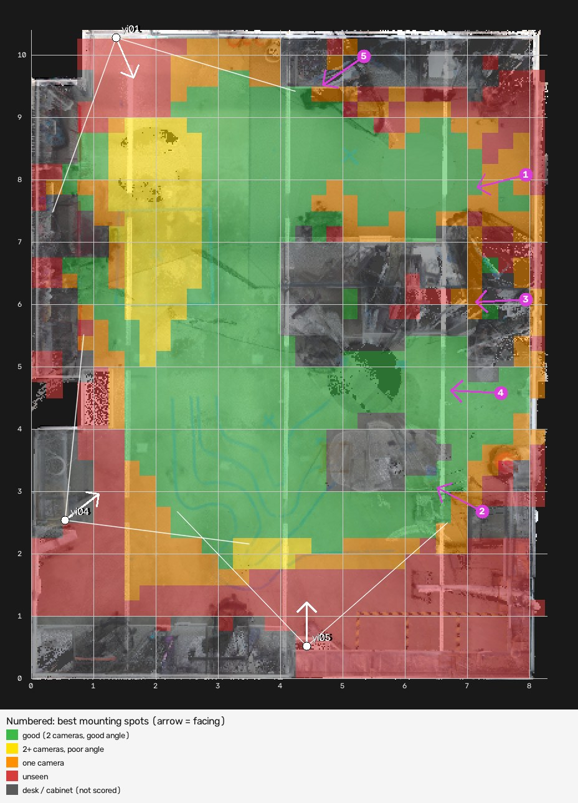
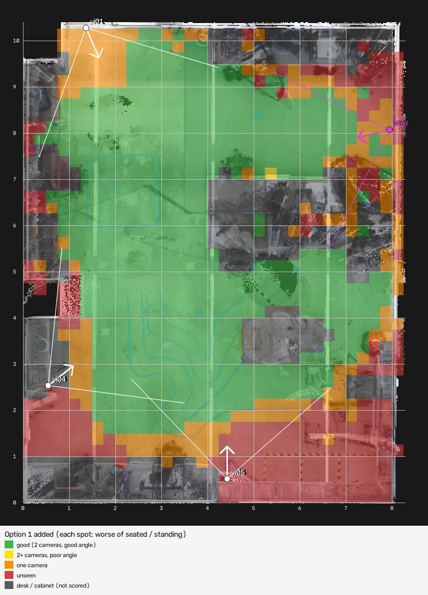
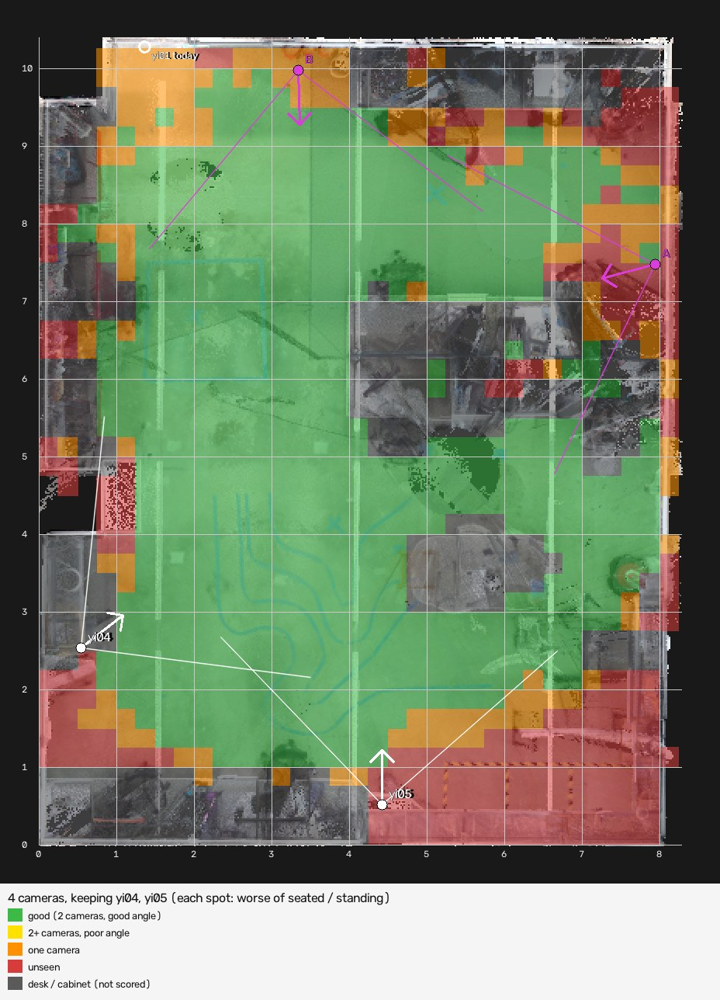
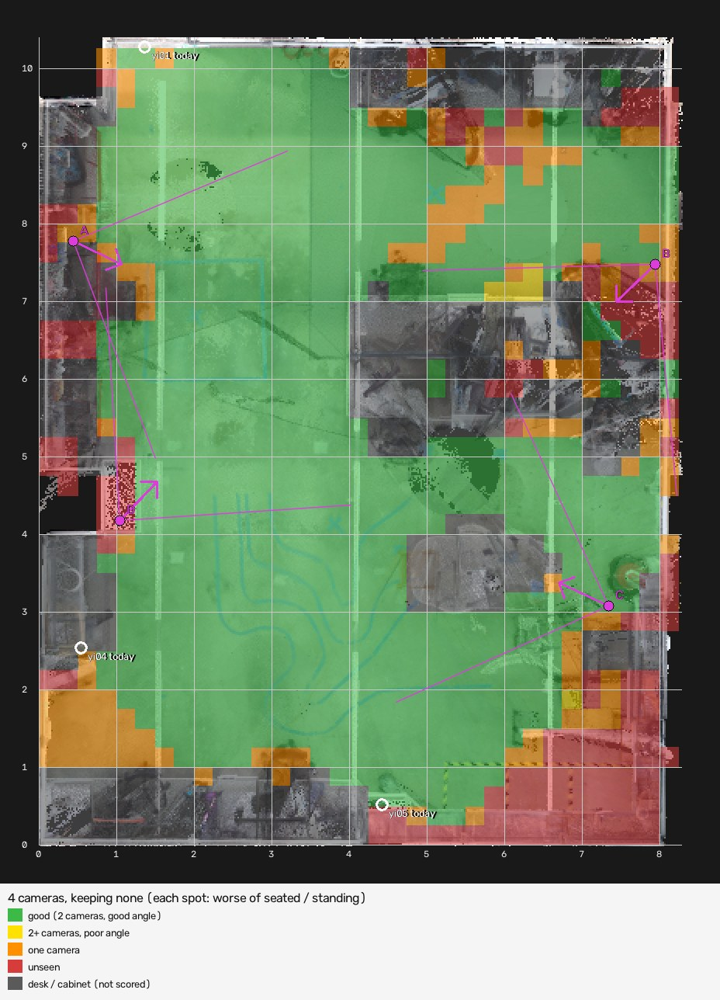

# Camera coverage of the lab (October 2026)

Results of `tools/coverage_planner.py` (where to add a fourth camera) and
`tools/layout_planner.py` (where to put all four) for the three current cameras
(yi01, yi04, yi05). Generated in October 2026 from the lab scan
(`data/smart_lab.las`) and the calibration in `calib/`.

## How to read the maps

Every 25 cm square of floor is coloured by how the cameras see a person there:

| Colour | Meaning |
|---|---|
| Green: good | Two cameras see the person from directions at least 25° apart, so the tracker measures their height and posture and keeps neighbours apart |
| Yellow: poor angle | Two or more cameras, but from nearly the same direction (their lines of sight cross badly) |
| Orange: one camera | Position comes from an assumed height; posture is guessed |
| Red: unseen | No camera sees the person |
| Grey | Desks and cabinets found in the scan (not scored) |

A camera "sees" a spot when the person's head and shoulders are inside its picture
(using the real lens shape), within 9 m, and its lines of sight are not blocked by
anything in the scan, such as walls, shelves or monitors. Map coordinates are meters
from the scan's bottom-left corner, as on the tracker's map.

The maps in this folder score both a seated and a standing person. Each square shows
the worse of the two. `seated/` and `standing/` hold the results for one posture each.

## Today

| | Seated person | Standing person |
|---|---|---|
| Good | 28.8 m² | 35.8 m² |
| Poor angle | 5.1 m² | 3.6 m² |
| One camera | 9.9 m² | 7.9 m² |
| Unseen | 19.1 m² | 15.7 m² |

62.9 m² of floor is scored. Almost all of the poor-angle floor lies along the line
between **yi01 and yi05**, which face each other from opposite ends of the room.


## Best places for a fourth camera

All at 2.5 m high. "Face towards" is where the camera's facing direction meets the
far side of the room, seen from above.

| Option | Mount at (x, y) | Face towards | Tilt down | Good floor added (seated / standing) | Shared with today's cameras |
|---|---|---|---|---|---|
| **1** | **(7.94, 8.08)** right wall | (0.0, 5.95) | 16° | **+10.3 / +7.3 m²** | 34.0 m² |
| 2 | (7.24, 2.68) | (0.0, 6.37) | 28° | +9.3 / +7.5 m² | 32.4 m² |
| 3 | (7.94, 6.08) right wall | (0.0, 5.66) | 24° | +9.4 / +6.8 m² | 32.3 m² |
| 4 | (7.54, 4.58) | (0.0, 4.97) | 18° | +8.8 / +6.6 m² | 27.6 m² |
| 5 | (5.34, 9.98) top wall | (0.0, 6.10) | 30° | +9.6 / +7.1 m² | 29.4 m² |



**Recommendation: option 1.** It looks across the room from the side, which is what
the yi01 to yi05 line needs, and it removes almost all poor-angle floor. The tilt
is not critical: anything from about 15° to 30° changes the good floor by less than
0.3 m². A tilt near 26° is easier to aim, because the centre of the picture then
lands on floor point (3.0, 6.75) inside the room (39.1 m² good for a seated person,
42.9 m² for a standing one).



The other options are in `coverage_option_2.jpg` to `coverage_option_5.jpg`, and all
the numbers are in `coverage_plan.json`.

## Best positions for all four cameras

Adding the fourth camera already means a new calibration walk with every camera, so
moving the existing cameras at the same time costs only the remounting. To see
whether that is worth it, `tools/layout_planner.py --variants` searched for the
best four-camera layout for each number of today's cameras left where they are
(trying every choice of which ones to keep). It scores each of about 3,000 possible
camera positions once, then searches layouts: a greedy start, swapping one camera
at a time while that helps, from 30 random starts (different starts all reached
the same best layout). Every camera must share at least 2 m² of floor with another,
so the calibration walk can link them, and tilts stay at 15° or more: a flatter
camera sees further, but in a busy room people in front hide the people behind,
which the planner does not model.

| Plan | Cameras remounted | Good, seated | Good, standing | Unseen, seated | Map |
|---|---|---|---|---|---|
| Today (3 cameras) | - | 28.8 m² | 35.8 m² | 19.1 m² | `coverage_current.jpg` |
| Keep all three, add one | 0 | 39.1 m² | 43.1 m² | 13.9 m² | `coverage_option_1.jpg` |
| Keep yi04 and yi05, move yi01, add one | 1 | 43.0 m² | 47.0 m² | 12.1 m² | `layout/layout_keep_yi04+yi05.jpg` |
| Keep yi04, move yi01 and yi05, add one | 2 | 45.6 m² | 50.4 m² | 8.9 m² | `layout/layout_keep_yi04.jpg` |
| Place all four from scratch | 3 | 47.5 m² | 53.1 m² | 8.0 m² | `layout/layout_keep_none.jpg` |

Each camera moved gains less than the one before: about 4 m² of good floor for the
first, 3 m² for the second and 2 m² for the third.

**Moving one camera** gives most of the benefit for the least work. yi04 and yi05
stay; yi01 slides about 2 m along the same wall and the new camera goes on the right
wall:

| Camera | Mount at (x, y), 2.5 m high | Face towards | Tilt down | Picture centre on the floor |
|---|---|---|---|---|
| yi04, yi05 | stay where they are | | | |
| yi01 (moved) | (3.34, 9.98) top wall | (3.86, 0.00) | 24° | (3.64, 4.37) |
| New camera | (7.94, 7.48) right wall | (0.00, 5.35) | 24° | (2.52, 6.02) |



**Placing all four from scratch** gives the most coverage: two cameras on each long
wall, each looking across the room.

| Camera | Mount at (x, y), 2.5 m high | Face towards | Tilt down | Picture centre on the floor |
|---|---|---|---|---|
| A | (0.44, 7.78) left wall | (8.28, 3.78) | 23° | (5.69, 5.10) |
| B | (7.94, 7.48) right wall | (0.46, 0.00) | 28° | (4.62, 4.15) |
| C | (7.34, 3.08) right side | (0.00, 6.35) | 16° | beyond the far wall |
| D | (1.04, 4.18) left side, beside tall furniture | (7.25, 10.39) | 16° | (7.21, 10.34) |



On the maps, white cameras stay where they are, magenta ones are new positions, and
an outlined dot marks where a camera that moves is today. Any of the Yi cameras can
go to any of the new positions; each keeps its own lens file. All numbers are in
`layout/layout_plan.json`.

For "keep all three, add one", the layout search picks (7.74, 3.48) on the right wall
instead of (7.94, 8.08). The two score the same (53.6), so either works.

## Before mounting

- The scan is a snapshot. Furniture moved since then, or glass the scanner saw
  through, is not known. Hold the camera at the spot and check its live view first.
- The planner does not know which walls or furniture can take a mount. To compare
  only the spots that are possible, run
  `python tools/coverage_planner.py --spot x,y --spot x,y`.
- The strip along the bottom of the map (y below about 1.5 m) stays unseen with every
  option. If people sit at the benches there, score only that area with
  `--focus 0,0,8.3,2`.
- Then follow "Adding a camera" in the main README: camera setup, lens calibration,
  `config.yaml`, and a new calibration walk with all four cameras.

## Regenerate

```bash
python tools/coverage_planner.py --image-format jpg --out docs/coverage
python tools/coverage_planner.py --posture seated --top 3 --image-format jpg --out docs/coverage/seated
python tools/coverage_planner.py --posture standing --top 3 --image-format jpg --out docs/coverage/standing
python tools/layout_planner.py --variants --image-format jpg --out docs/coverage/layout
```

Rerun after any camera is moved, added or recalibrated.
