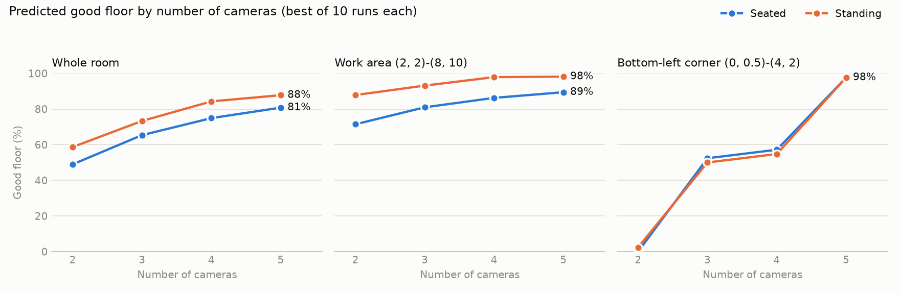

# How many cameras does the lab need? (November 2026)

The planner found the best layout for 2, 3, 4 and 5 cameras, using only the mounting
places marked with `tools/mount_editor.py`. These are **predictions** from the lab
scan. The study will install each layout, calibrate it and measure how well people
are actually located, so these numbers are what the measurements will be compared
against.



## What was run

- **Mounting places:** the 13 lines in `data/mount_lines.json`, each at its own height
  (1.9 to 2.6 m), picked from the scan's side view. The pillar faces (L7 to L9) are
  included. No camera is kept where it is today.
- **Priority:** the work area (2, 2) to (8, 10) and the bottom-left corner (0, 0.5) to
  (4, 2) count twice; the rest of the room counts once.
- **Search:** for each number of cameras, 10 independent runs (seeds 0 to 9), each
  trying 60 randomised starts. The best run is kept.
- **Rules (planner defaults):** a spot is **good** when two cameras see the person's
  head and shoulders and their lines of sight cross at 25° or more; cameras see up to
  9 m; every camera shares at least 2 m² of floor with another (needed for the
  calibration walk); cameras are at least 1 m apart. Seated and standing people are
  both scored.

## Results

Share of floor that is **good**, written as **seated / standing** (%).

| Cameras | Whole room | Work area (2, 2)-(8, 10) | Bottom-left corner (0, 0.5)-(4, 2) | Unseen, whole room | Gain in good floor |
|---|---|---|---|---|---|
| 2 | 49 / 59 | 71 / 88 | 0 / 2 | 27 / 23 | n/a |
| 3 | 65 / 73 | 81 / 93 | 52 / 50 | 17 / 15 | +16 / +15 |
| 4 | 75 / 84 | 86 / 98 | 57 / 55 | 13 / 9 | +10 / +11 |
| 5 | 81 / 88 | 89 / 98 | 98 / 98 | 13 / 9 | +6 / +3 |

What this shows:

- **Each camera adds less than the one before.** Good floor in the whole room rises by
  16 / 15 points from 2 to 3 cameras, 10 / 11 from 3 to 4, and 6 / 3 from 4 to 5.
- **Four cameras cover the work area almost fully for standing people (98%)**, and 86%
  for seated people. A fifth camera adds little there (89 / 98).
- **The fifth camera mainly fixes the bottom-left corner**, from 57 / 55 to 98 / 98.
- **Some floor stays unseen even with 5 cameras** (13 / 9%), mostly the bottom-right
  area (x 5 to 8, y 0 to 1.5) and strips along the walls. The bottom-right area is
  outside both priority zones, so the planner does not spend cameras on it.
- **Seated people are always harder than standing ones**, because desks and monitors
  hide them; the gap is largest with few cameras.

## How much the 10 runs agreed

| Cameras | Runs within 0.5% of the best | Score range | Largest camera move between runs |
|---|---|---|---|
| 2 | 10 of 10 | 85.0 to 85.0 | 0.00 m |
| 3 | 10 of 10 | 102.0 to 102.0 | 0.00 m |
| 4 | 10 of 10 | 111.2 to 111.5 | 0.50 m |
| 5 | 10 of 10 | 116.8 to 116.8 | 0.00 m |

For 2, 3 and 5 cameras every run found the same layout. For 4 cameras there are two
almost equal layouts (scores 111.2 and 111.5) that differ by one camera moving up to
0.5 m; the higher one (seed 3) is used. The search is therefore not sensitive to its
starting point, so the layouts below can be treated as the planner's answer.

## Where to mount each layout

**Mount on line** is the line drawn in the mount editor. **Wall point** is where to fix
the camera on that line, at the given **height**. **Lens at** is where the planner
places the lens, 0.15 to 0.35 m in front of the wall, which is about where a bracket
holds it. Turn the camera to face the **face towards** point and tilt it down by the
given angle.

The layouts are not built from each other: the best 4-camera layout does not contain
the best 3-camera layout. Every camera count needs its own mounting and calibration
walk.

**2 cameras** (map: [`2_cameras/layout_keep_none.jpg`](2_cameras/layout_keep_none.jpg))

| Camera | Mount on line | Wall point x, y (m) | Height (m) | Lens at x, y (m) | Face towards x, y | Tilt down |
|---|---|---|---|---|---|---|
| A | L2 | 8.09, 9.88 | 2.52 | 7.84, 9.88 | 0.00, 2.04 | 30° |
| B | L1 | 1.84, 10.39 | 2.60 | 1.84, 10.08 | 8.28, 0.16 | 30° |

**3 cameras** (map: [`3_cameras/layout_keep_none.jpg`](3_cameras/layout_keep_none.jpg))

| Camera | Mount on line | Wall point x, y (m) | Height (m) | Lens at x, y (m) | Face towards x, y | Tilt down |
|---|---|---|---|---|---|---|
| A | L2 | 8.09, 10.08 | 2.52 | 7.84, 10.08 | 0.00, 3.02 | 28° |
| B | L1 | 2.44, 10.39 | 2.60 | 2.44, 10.08 | 8.26, 0.00 | 18° |
| C | L2 | 8.09, 3.68 | 2.52 | 7.84, 3.68 | 0.00, 6.23 | 22° |

**4 cameras** (map: [`4_cameras/layout_keep_none.jpg`](4_cameras/layout_keep_none.jpg))

| Camera | Mount on line | Wall point x, y (m) | Height (m) | Lens at x, y (m) | Face towards x, y | Tilt down |
|---|---|---|---|---|---|---|
| A | L2 | 8.09, 3.68 | 2.52 | 7.84, 3.68 | 0.00, 6.69 | 22° |
| B | L2 | 8.09, 7.78 | 2.52 | 7.94, 7.78 | 0.16, 0.00 | 30° |
| C | L10 | 0.07, 7.98 | 2.56 | 0.34, 7.98 | 8.28, 3.39 | 17° |
| D | L8 | 0.82, 4.08 | 2.48 | 1.04, 4.08 | 7.35, 10.39 | 16° |

**5 cameras** (map: [`5_cameras/layout_keep_none.jpg`](5_cameras/layout_keep_none.jpg))

| Camera | Mount on line | Wall point x, y (m) | Height (m) | Lens at x, y (m) | Face towards x, y | Tilt down |
|---|---|---|---|---|---|---|
| A | L10 | 0.07, 7.98 | 2.56 | 0.34, 7.98 | 8.28, 3.39 | 28° |
| B | L2 | 8.09, 6.28 | 2.52 | 7.94, 6.28 | 3.38, 0.00 | 32° |
| C | L2 | 8.09, 4.18 | 2.52 | 7.74, 4.18 | 1.53, 10.39 | 28° |
| D | L4 | 4.84, 0.44 | 2.44 | 4.84, 0.68 | 0.00, 5.52 | 20° |
| E | L8 | 0.82, 4.08 | 2.48 | 1.04, 4.08 | 7.35, 10.39 | 16° |

On the maps, each floor square shows the worse of seated and standing. Magenta dots
are the planned cameras and white circles are where the cameras are today (for
reference only). `layout_plan.json` in each folder has the full numbers, every run's
layout and score, and the settings.

## Limits

- These are predictions from the scan. The 25° crossing angle and 9 m range are
  assumptions that the study is testing, not measured values.
- The scan is a snapshot. Objects added since it was taken, such as the TV in front of
  yi05, are not in it yet.
- The lab has four cameras, so the 5-camera layout needs one more before it can be
  tested.
- The numbers are not compared with today's cameras: yi04's temporary calibration puts
  it inside the pillar, which would make today's coverage look worse than it is.

## Reproduce

```bash
for n in 2 3 4 5; do
  python tools/layout_planner.py --mount-lines data/mount_lines.json \
    --weight 2,2,8,10,2 --weight 0,0.5,4,2,2 --cameras $n --runs 10 --restarts 60 \
    --image-format jpg --out docs/coverage/camera_count/${n}_cameras
done
python docs/coverage/camera_count/summary.py   # chart, summary.json and the tables above
```

On a Mac the four searches took 54 s, 105 s, 160 s and 253 s.
