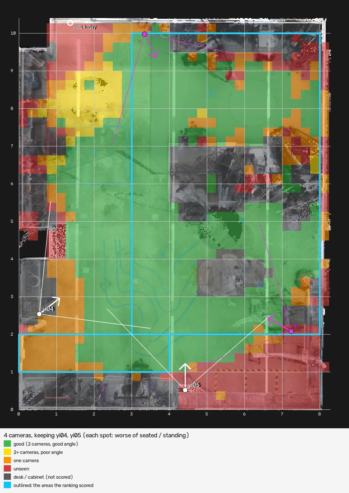

# Coverage of the priority work areas (October 2026)

Most people work in the area from **(3, 2) to (8, 10)** on the map. The corner from
**(0, 1) to (4, 2)** also matters and is where many misses happen today. The runs
in this folder rank options by those two areas only (the middle corridor lies
inside the first one). The maps still show coverage for the whole room, with the
two scored areas outlined in light blue. The results for
the whole room are one folder up, in [`../README.md`](../README.md).

Numbers below are for a **seated** person, the harder case, as "% good / % unseen"
of each area (good = seen by two cameras whose lines of sight cross at 25° or
more, so height and posture are measured). Standing results are in the JSON files.

## Today

| Area | Good | Unseen |
|---|---|---|
| Work area (3,2)–(8,10) | 73% | 10% |
| Corner (0,1)–(4,2) | 2% | 70% |
| Corner around (8, 9), i.e. (7,8)–(8.3,10.4) | 5% | 67% |

### Why the (8, 9) corner reads seated people as standing and misplaces them

- yi01 cannot see the corner: it is outside its picture.
- yi04 and yi05 see it from 9–10 m away, where a seated person is only about
  120–145 pixels tall in their picture. The desks hide the legs and the monitors
  (1.0–1.5 m high) often hide the shoulders.
- yi04 and yi05 look at the corner from nearly the same direction (26° apart),
  so the height is almost never measured and the posture is guessed from a small,
  half-hidden body. It often comes out "standing".
- Taking a seated person as standing places their shoulders higher, which the
  cameras' lines of sight reach sooner: yi04 then puts them at about (6.3, 7.5)
  and yi05 at about (7.2, 7.0). Together that is the "around (6, 8)" seen live.

## Options compared (seated person, % good / % unseen)

| Layout | Work area | Corner (0,1)–(4,2) | Corner at (8, 9) | Whole room |
|---|---|---|---|---|
| Today | 73 / 10 | 2 / 70 | 5 / 67 | 46 / 30 |
| Add one on the right wall at (7.94, 8.08) (best for the whole room) | 79 / 8 | 28 / 45 | 10 / 62 | 62 / 22 |
| Add one on the top wall at (5.34, 9.98) (best single camera for these areas) | 84 / 6 | 22 / 60 | 33 / 43 | 55 / 24 |
| **Keep yi04 and yi05, move yi01, add one** | **84 / 7** | **57 / 0** | **33 / 43** | **62 / 19** |
| Keep yi04, move yi01 and yi05, add one | 87 / 4 | 78 / 2 | 48 / 29 | 61 / 16 |
| Move all four | 87 / 4 | 85 / 2 | 52 / 24 | 68 / 16 |

- The right-wall camera is mounted next to the (8, 9) corner but faces away from
  it, so it hardly helps there.
- No single added camera fixes both corners.
- Adding the fourth camera already means a new calibration walk with every camera,
  so moving yi01 at the same time costs only the remounting.

## Recommendation: keep yi04 and yi05, move yi01, add one

| Camera | Mount at (x, y), 2.5 m high | Face towards | Tilt down | Picture centre on the floor |
|---|---|---|---|---|
| yi04, yi05 | stay where they are | | | |
| yi01 (moved about 2 m along the top wall) | (3.34, 9.98) | (8.28, 0.28) | 28° | (5.48, 5.79) |
| New camera | (7.24, 2.08), beside something tall in the scan; check it can take a mount | (0.00, 6.26) | 30° | (3.49, 4.24) |

"Face towards" is where the camera's facing direction meets the far side of the
room, seen from above. Aim by having someone stand at the "picture centre" point
and centring them in the camera's live view.



If only one camera can be added and none moved, the best for these areas is the
top wall at **(5.34, 9.98)**, facing towards (8.02, 0.00), tilted 30° down
(picture centre at (6.46, 5.80)): `add_one/coverage_option_1.jpg`.

## The (8, 9) corner stays the weakest spot

Even moving all four cameras reaches only about 50% good there: the monitors
hide seated people's shoulders from almost every direction. Beyond camera
placement, rearranging the monitors there would help, and the tracker could be
made less ready to call a small, far-away person "standing". A short recording
of someone seated at (8, 9) (`autocalib.py record`) would show which part of
the posture guess goes wrong.

## Files

| Folder | Contents |
|---|---|
| `add_one/` | Today's three cameras plus the best fourth: today, ranked spots, each option added, `coverage_plan.json` |
| `layout/` | Best layouts for each number of current cameras kept: `layout_keep_*.jpg`, `layout_plan.json` |

## Regenerate

```bash
python tools/coverage_planner.py --focus 3,2,8,10 --focus 0,1,4,2 --image-format jpg --out docs/coverage/priority/add_one
python tools/layout_planner.py --variants --focus 3,2,8,10 --focus 0,1,4,2 --image-format jpg --out docs/coverage/priority/layout
```

The per-area table scores each rectangle separately with `--focus` (for example
`--focus 7,8,8.3,10.4` for the corner).
