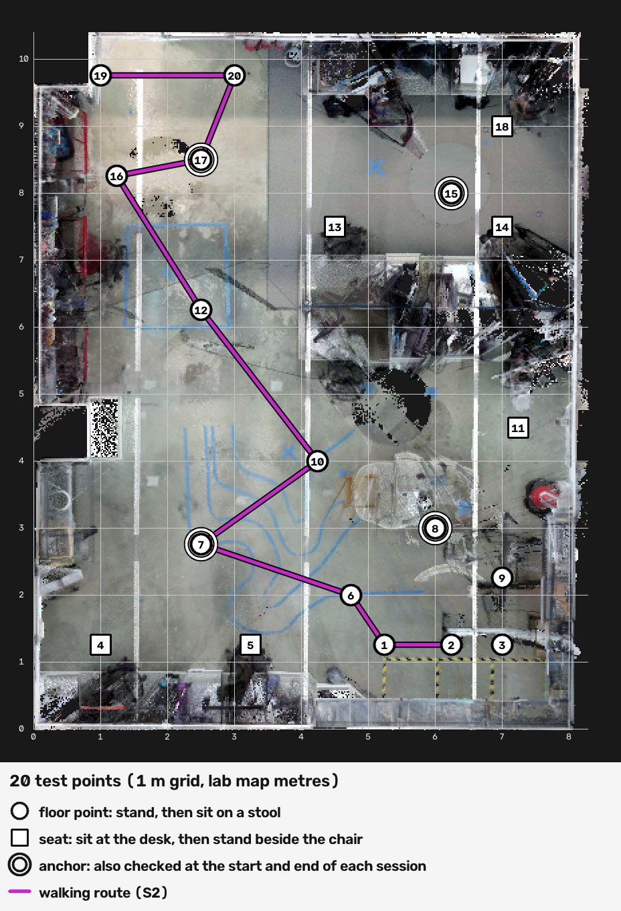

# Test points for the camera-count validation (November 2026)

The 20 taped points used to test the 2, 3 and 4 camera layouts in
`docs/coverage/camera_count/`. The same points are used for every layout, so a
point whose rating changes between layouts can be compared with itself.



- **Floor points (circles):** stand, then sit on a stool.
- **Seats (squares):** sit at the desk as when working, then stand beside the chair.
  Their positions are rough: measure each real chair spot, update
  `data/test_points.json` and rerun the command below before taping.
- **Anchors (P7, P8, P15, P17):** also checked at the start and end of each session,
  to see whether the positions drift during a session.
- **Second person:** repeats P2, P5, P9, P10, P13, P16 and P20.
- **Walking route (S2):** P2, P1, P6, P7, P10, P12, P16, P17, P20, P19, 16.3 m.
  Every leg is clear of desks and walls in the scan; walk it once before taping,
  since furniture may have moved.

## Predicted ratings (seated / standing)

| Point | Kind | 2 cameras | 3 cameras | 4 cameras |
|---|---|---|---|---|
| P1 | floor | one camera | one camera | good |
| P2 | floor | unseen | unseen | one camera |
| P3 | floor | unseen | unseen | unseen |
| P4 | seat | unseen | unseen | one camera |
| P5 | seat | one camera | good | good |
| P6 | floor | good | good | good |
| P7 | floor | good | good | good |
| P8 | floor | good | good | good |
| P9 | floor | one camera | unseen | one camera |
| P10 | floor | good | good | good |
| P11 | seat | one camera | good | good |
| P12 | floor | good | good | good |
| P13 | seat | one camera / good | good | good |
| P14 | seat | good | one camera / good | one camera / good |
| P15 | floor | good | good | good |
| P16 | floor | one camera | one camera | good |
| P17 | floor | good | good | good |
| P18 | seat | unseen | good | good |
| P19 | floor | unseen | unseen | unseen |
| P20 | floor | unseen | good | good |

One rating means seated and standing agree. 11 points change rating between
layouts. Poor angle is left out because the planned layouts have almost none
(0.4 m2 at most).

`test_points.json` also gives, for each point, layout and posture: the cameras that
see the person, the widest crossing angle between two of them, the distance to the
nearest, and how many of 8 spots 0.3 m around share the rating. A low count means the
point is near the edge of its rating, so a small error in the mark or the mounting
can change it (P13 and P14 are like this, and P9 in the 3 camera layout).
`test_points_<n>_cameras.jpg` shows the points on each
layout's map.

## Reproduce

```bash
python tools/test_points.py --points data/test_points.json \
  --layout docs/coverage/camera_count/2_cameras/layout_plan.json \
  --layout docs/coverage/camera_count/3_cameras/layout_plan.json \
  --layout docs/coverage/camera_count/4_cameras/layout_plan.json \
  --out docs/coverage/validation
```

To predict for the cameras as built, pass a layout file with their measured
positions instead.
